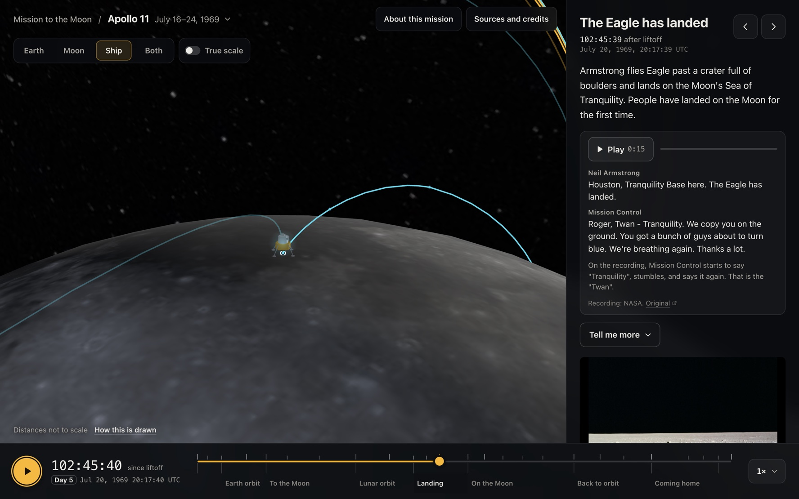
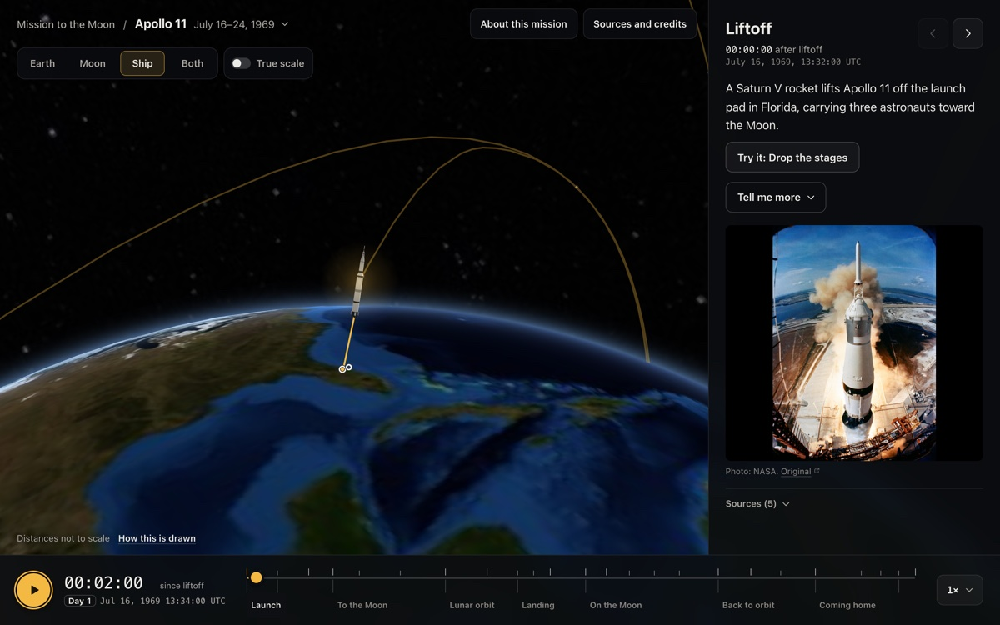
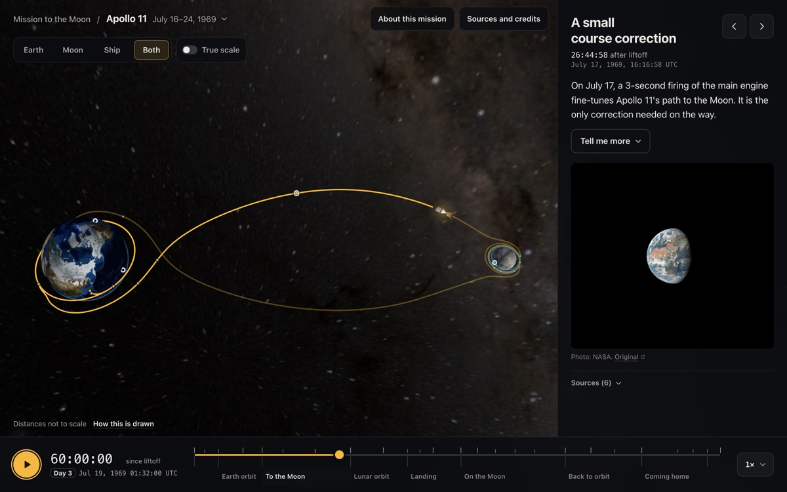
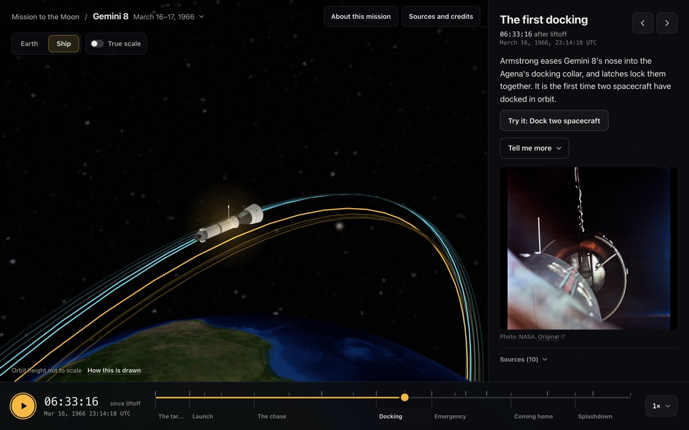
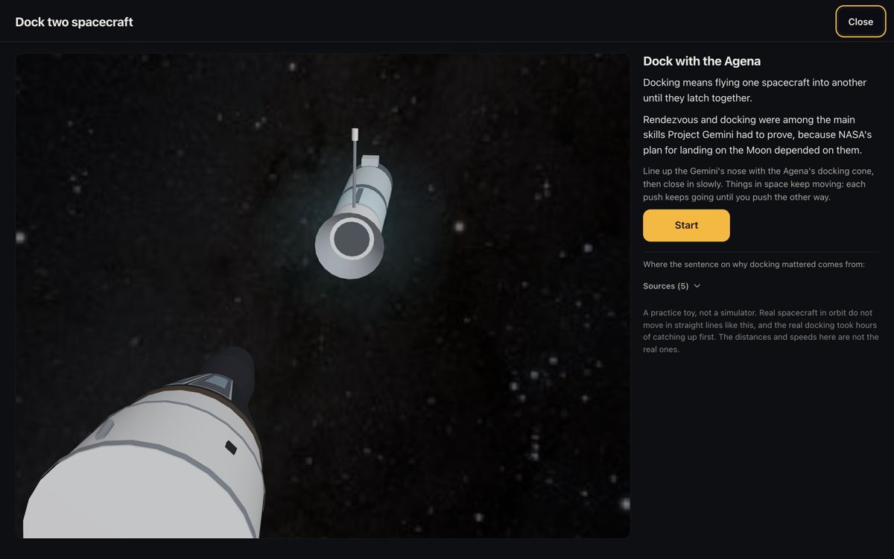
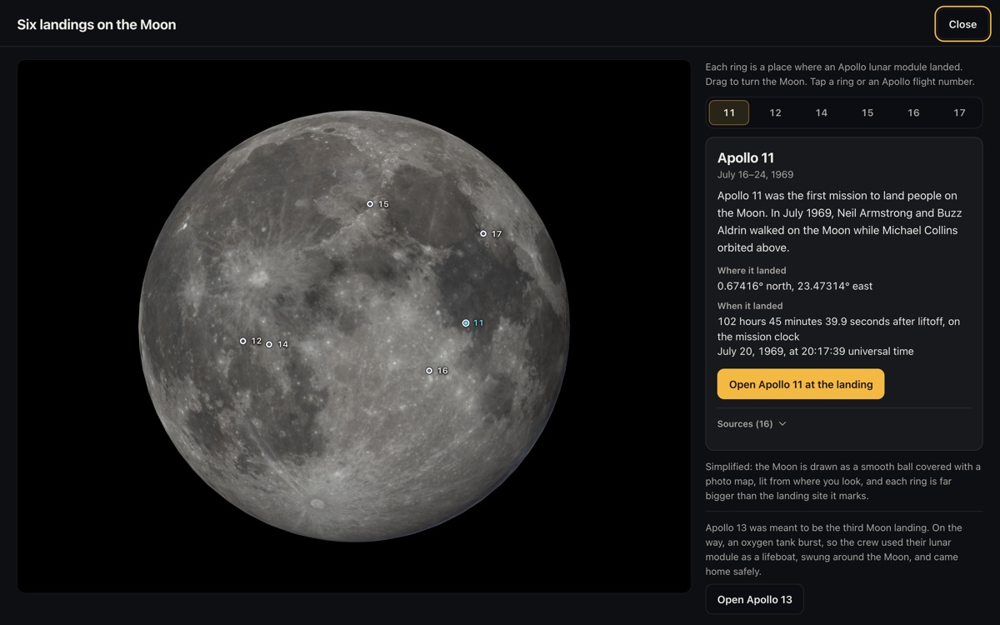
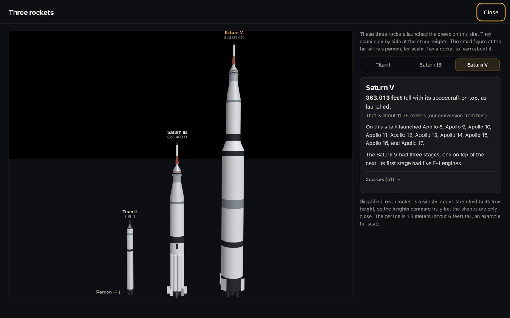

<h1 align="center">Mission to the Moon</h1>
<h3 align="center">Ride along, from liftoff to splashdown</h3>

  An interactive 3D tour of every crewed Gemini and Apollo flight, in your browser, on a phone or a desktop.
   
  <a href="https://rquellh.github.io/mission-to-the-moon/">Fly a mission</a>
  ·
  <a href="#about">About</a>
  ·
  <a href="#the-flights">The flights</a>
  ·
  <a href="#things-to-try">Things to try</a>
  ·
  <a href="#what-is-real-and-what-is-drawn">What is real</a>
  ·
  <a href="DEVELOPING.md">Developing</a>

## About

Between March 1965 and December 1972, NASA flew 21 crews on the way to the Moon. Ten Gemini
flights practiced the hard parts in Earth orbit. Eleven Apollo flights then tested the spacecraft,
went around the Moon, and landed on it six times. Mission to the Moon lets you ride along on
every one of them.

Pick a mission and press play, or drag the timeline. The clock shows real mission time, and the
trip is paced so every stretch is worth watching: you get the burns, the dockings, and the
landings, without the days of coasting in between. Take the **Tour** to step through a mission's
key moments, or **Explore** and roam on your own. Drag to turn the view, pinch or scroll to zoom,
and choose what the camera follows: Earth, the ship, or the Moon. **True scale** shows how far
apart everything really is.

Each moment has a short card, a longer "Tell me more", a NASA photo where there is one, and the
sources it came from. A few carry a real NASA recording of the moment, with every word written out
beside the player.

  
  
  

## The flights

Every crewed flight of the two programs is here, from Gemini 3 to Apollo 17.

- **Gemini** (1965 to 1966): Gemini 3, 4, 5, 7, 6A, 8, 9A, 10, 11, and 12. Ten flights in Earth
  orbit that practiced what a trip to the Moon would need: long flights, spacewalks, and meeting
  and docking with another spacecraft.
- **Apollo** (1967 to 1972): Apollo 7 through 17, including the first trip around the Moon
  (Apollo 8), the first landing (Apollo 11), the flight that had to turn back (Apollo 13), and the
  three long stays with a rover (Apollo 15, 16, and 17).
- **Apollo 1** has a page of remembrance in place of a flight.

Some good places to start:

- [The first landing](https://rquellh.github.io/mission-to-the-moon/?mission=apollo-11&t=102:45:40&view=moon), Apollo 11, a little under 103 hours after liftoff
- [The first docking](https://rquellh.github.io/mission-to-the-moon/?mission=gemini-8&t=06:33:16&view=spacecraft), Gemini 8, six and a half hours in
- [The first trip around the Moon](https://rquellh.github.io/mission-to-the-moon/?mission=apollo-8&start=tour), Apollo 8, as a tour
- [The flight that had to turn back](https://rquellh.github.io/mission-to-the-moon/?mission=apollo-13&start=tour), Apollo 13, as a tour

Those are ordinary links, and any moment of any flight can be one.
[Links that open a moment](docs/links.md) lists the options.

## Things to try

Under the missions are five things to try and explore:

- [**Drop the stages**](https://rquellh.github.io/mission-to-the-moon/?extra=stages): help a rocket climb to orbit by dropping each part at the right moment.
- [**Dock two spacecraft**](https://rquellh.github.io/mission-to-the-moon/?extra=docking): fly a Gemini slowly into the docking cone of its Agena target, the way Gemini 8's crew did first.
- [**Six landings on the Moon**](https://rquellh.github.io/mission-to-the-moon/?extra=landing-sites): turn the Moon and find the six places where an Apollo lunar module landed.
- [**Three rockets**](https://rquellh.github.io/mission-to-the-moon/?extra=rockets): the three rockets that launched the Gemini and Apollo crews, side by side at their true heights.
- [**Mission patches**](https://rquellh.github.io/mission-to-the-moon/?extra=patches): a book of the crews' patches that fills in, in color, as you open each flight. The book is kept on your own device.

A liftoff or docking card in a mission offers the matching one with a "Try it" button.

  
  
  

## What is real and what is drawn

The times, places, and facts are real. Each one comes from a cited source, and each mission was
checked against its sources before it went on the list.

The picture is a drawing. The flight path is computed from the published points of each flight
(burns, orbits, landing, splashdown) and drawn as a smooth curve between them, so it shows the
shape of the trip and not every turn. The spacecraft are simple shapes, drawn far larger than
life so you can see them. The two hands-on things to try, dropping the stages and docking, are
practice toys, not simulators, and say so on screen.

"How this is drawn" on the site explains the same thing, and
[What is real and what is drawn](docs/accuracy.md) has the full account, with how the facts are
kept honest.

Three principles hold throughout:

- Every fact on the site is cited to NASA, the Smithsonian, or a similarly authoritative source.
- Real NASA and Smithsonian media only. No AI-generated imagery.
- No third-party requests at runtime: no CDNs, web fonts, or analytics. Everything the site needs
  ships with it.

## Developing

The site is TypeScript and three.js. [DEVELOPING.md](DEVELOPING.md) covers running it on your own
machine, the tests, how the folders are laid out, and how to add a mission, which is one folder.

## Status

All 21 flights, the Apollo 1 page, and the five things to try are in. What is left is polish
before launch.
